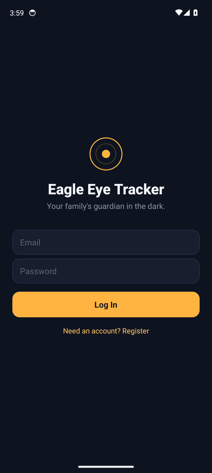
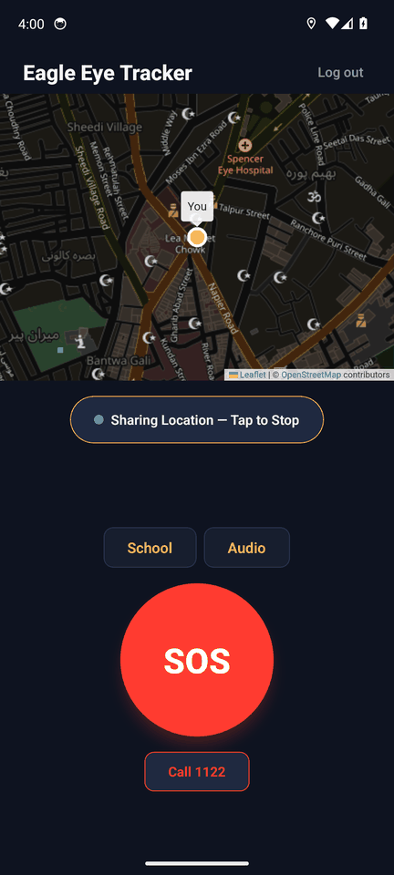
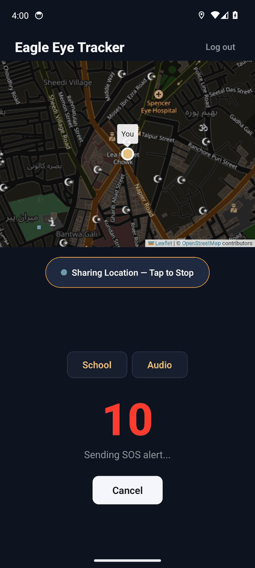
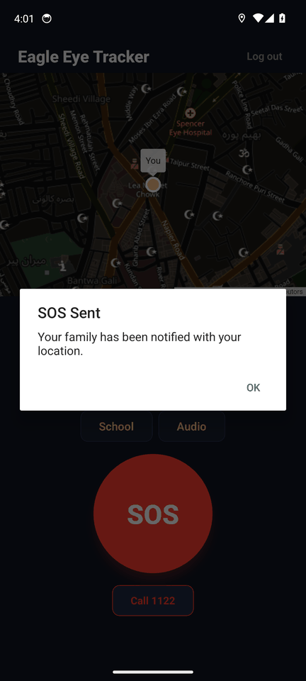
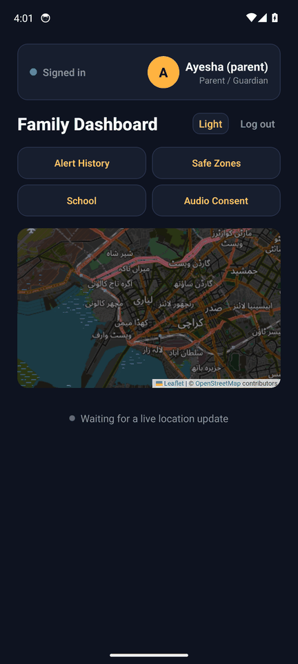
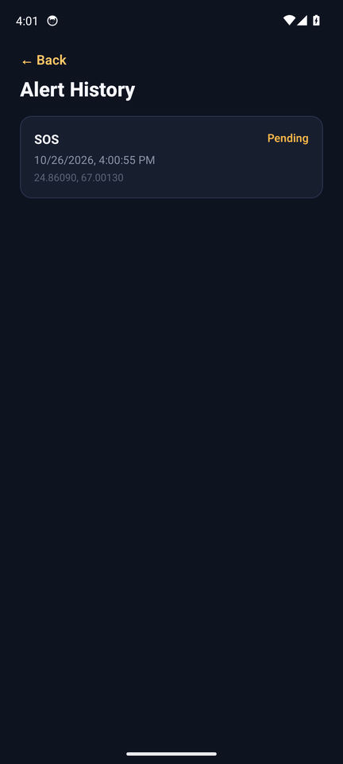
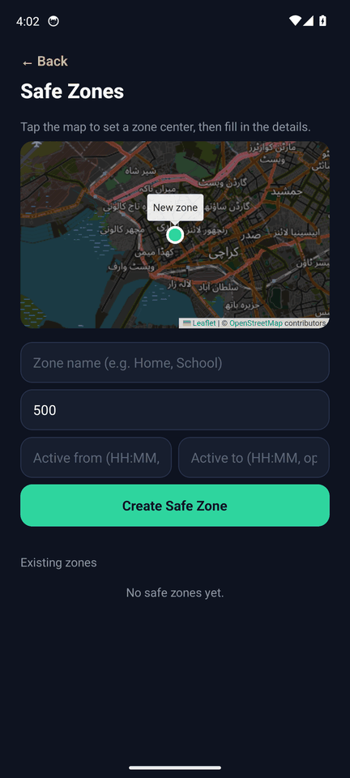

# Eagle Eye Tracker

Student safety app: real-time location sharing, manual SOS, crash detection, and geofencing for parents/guardians. See [`docs/REVISED_SPEC.md`](docs/REVISED_SPEC.md) for the full spec, schema, and Pakistan-market legal/consent design this build follows.

## Screenshots

Taken by the automated UI check ([`.github/workflows/android-ui-check.yml`](.github/workflows/android-ui-check.yml)):
the full stack (Node.js API, PostgreSQL/PostGIS, Redis) runs on a GitHub runner, a demo family is created through the
API, and a script drives the Android app on an emulator with the GPS set to Karachi.

<p>
  
  
  
  
</p>
<p>
  
  
  
</p>

Student: login, live location shared on the map, SOS with a 10-second cancelable countdown, "SOS Sent".
Parent: family dashboard, the SOS in alert history with the student's coordinates, safe zones.

Maps are OpenStreetMap (Leaflet in a WebView, [`mobile/src/components/OsmMap.tsx`](mobile/src/components/OsmMap.tsx)):
no API key and no billing account, and it also runs in Expo Go.

## Project Structure

```
backend/
  src/
    config/       env loading
    db/           pg connection pool
    middleware/   auth + family-scoped authorization
    routes/       API handlers (auth, family, location, zone, alert, user, upload)
    services/     FCM, geofence, OTP, audio storage, escalation fallback
    realtime/     Socket.io live-location channel
    jobs/         geofence evaluation worker
  migrations/     node-pg-migrate schema migrations

mobile/
  src/
    api/          fetch client + auth token store
    context/      auth state
    navigation/   stack navigator + route types
    screens/      Login, Register, FamilySetup, StudentHome, ParentDashboard,
                  AudioConsent, AlertHistory, SafeZones
    hooks/        location socket, audio recorder, crash detection, push
    components/   shared UI (crash confirmation modal)
    theme.ts      dark "night beacon" design tokens

docs/      Spec and design docs
docker-compose.yml   Postgres + Redis + backend for local dev
```

## Prerequisites

- Node.js 20+
- Docker Desktop (for Postgres/Redis) — or point `DATABASE_URL`/`REDIS_URL` at existing instances
- Expo Go app on your phone, or Android Studio / Xcode for emulators

## Backend Setup

```bash
cd backend
cp .env.example .env      # fill in JWT secrets at minimum to run locally
npm install
```

Start Postgres + Redis (from the repo root):

```bash
docker compose up -d postgres redis
```

**Without Docker:** any PostgreSQL with the PostGIS extension works (for example PostgreSQL + PostGIS inside WSL Ubuntu:
`sudo apt install postgresql postgis`, then create the `eagleeye` user/database used in `.env`). TimescaleDB is used
when it is installed; without it, `locations` is created as a regular table and everything else behaves the same.
Redis is optional for local development.

Run the database migration (creates all tables from `docs/REVISED_SPEC.md` §4):

```bash
npm run migrate up
```

Start the API in dev mode:

```bash
npm run dev
```

The server listens on `http://localhost:4000` (health check at `/health`). WebSocket live-location endpoint is at `/ws/location`.

### Environment variables

All backend variables live in `backend/.env` (see `backend/.env.example` for a template).

| Variable | Required | Purpose |
|---|---|---|
| `DATABASE_URL` | Yes | Postgres connection string (PostGIS + TimescaleDB) |
| `REDIS_URL` | No | Redis for Socket.io adapter + geofence cache (defaults to localhost) |
| `JWT_ACCESS_SECRET` | Yes | Signs access tokens |
| `JWT_REFRESH_SECRET` | Yes | Signs refresh tokens |
| `JWT_ACCESS_TTL` | No | Access token lifetime (default `15m`) |
| `JWT_REFRESH_TTL` | No | Refresh token lifetime (default `30d`) |
| `FCM_*` | No | Firebase service-account credentials for push |
| `S3_*` | No | S3-compatible object storage for audio/profile uploads |
| `WHATSAPP_*` | No | WhatsApp Business API (BSP) template alerts |
| `VOICE_API_*` | No | Outbound TTS voice-call escalation |
| `MAPS_API_KEY` | No | Not needed by the app (maps are OpenStreetMap); kept for a future server-side geocoding provider |

Mobile: `mobile/.env` uses `EXPO_PUBLIC_API_BASE_URL` to point at the backend (see the troubleshooting section below).

### What's implemented vs. stubbed

Implemented: auth (register/login/refresh), family groups with expiring single-use invite codes, device/FCM token registration, consent logging, phone OTP verification, live location over Socket.io with batched persistence, paginated location history, safe zones (CRUD), SOS/Crash alert creation with family-scoped authorization, per-parent acknowledgement, real FCM push sends (multicast, high priority, dead-token pruning), and a geofence worker that evaluates entry/exit against safe zones (push-only) with time-window support.

Stubbed (marked `TODO` in `src/services/` and `src/services/otpService.ts`) pending external accounts: WhatsApp Business API template send, outbound voice call via a telephony provider, and OTP delivery. Wire these up once the accounts in the section below are provisioned.

## Mobile Setup

```bash
cd mobile
npm install
```

Set the API URL the app should call — create `mobile/.env` (Expo picks up `EXPO_PUBLIC_*` vars automatically):

```
EXPO_PUBLIC_API_BASE_URL=http://10.0.2.2:4000   # Android emulator; use your LAN IP for a physical device
```

Start the dev server:

```bash
npx expo start
```

Scan the QR code with Expo Go, or press `a`/`i` for an Android/iOS emulator.

### Physical-device testing (Expo Go) + connection troubleshooting

Testing on a real phone requires the phone and PC to be on the **same network**, and the phone must reach the PC by its **Wi-Fi LAN IP** (not `127.0.0.1` and not the Docker `172.x` address).

Quick fix when the app can't connect:

1. **Get the PC's current Wi-Fi IP:**

   ```bash
   ipconfig
   ```

   Use the `192.168.x.x` (or `10.x.x.x`) address on your Wi-Fi adapter. Skip `127.0.0.1` (localhost) and `172.x.x.x` (Docker's internal network).

2. **Update `mobile/.env`** with the current IP:

   ```
   EXPO_PUBLIC_API_BASE_URL=http://192.168.x.x:4000
   ```

3. **Restart both servers** (from two terminals, or the command runner):

   ```bash
   # backend
   cd backend && npm run dev

   # expo (replace with the current IP)
   cd mobile && set REACT_NATIVE_PACKAGER_HOSTNAME=192.168.x.x && npx expo start --lan
   ```

4. **Rescan the QR** in Expo Go.

Why this happens: the router assigns the PC a lease via DHCP, and that address can change on Wi-Fi reconnect or lease expiry. The hardcoded `.env` value then points at a stale address.

Other common causes:

- **Different SSID / guest Wi-Fi** — the phone and PC must be on the same network segment. Guest networks often enable *client isolation*, which blocks device-to-device traffic even when both devices appear "connected."
- **Windows Firewall** — if login times out but the app loads, allow inbound connections on port `4000` (and `8081` for Metro).

### What's implemented vs. stubbed

Implemented: login/register, family invite/join flow, student home screen (map with live marker, share-location toggle, SOS button with 10s cancelable countdown, on-device 30s audio capture during SOS, crash detection with a 60s "Are you okay?" confirmation), audio consent screen (off by default, revocable, logged to `consent_logs`), parent dashboard (map with live student markers, live location list, full-screen emergency popup with Call Emergency/Acknowledge), alert history screen (paginated), safe zone management (map tap to set center, radius, optional time window, enable/disable), push registration on login, emergency-push tap → popup including cold start, live location over the shared WebSocket hook.

Stubbed / next up (needs external accounts): upload of recorded audio to object storage, WhatsApp/voice escalation, OTP delivery.

## Accounts Needed Before Full Integration Testing

- Firebase project (FCM push)
- No maps key: the app uses OpenStreetMap tiles. Their usage policy is meant for light use, so a production launch
  with many users should switch the tile URL in `OsmMap.tsx` to a paid or self-hosted tile provider
- S3-compatible object storage (profile pictures, transient audio clips)
- WhatsApp Business API access via a BSP (e.g. Infobip, Gupshup) + pre-approved SOS template
- Telephony provider for outbound TTS voice calls (e.g. Twilio Voice, or a local provider)

## Automated UI check

Every push to `ci/android-ui-check` (or a manual run from the Actions tab) builds the release APK, starts the backend
with PostGIS and Redis as service containers, creates a demo parent and student through the API
([`.github/scripts/seed_demo.sh`](.github/scripts/seed_demo.sh)) and runs
[`.github/scripts/ui_check.sh`](.github/scripts/ui_check.sh) on an Android 14 emulator. Screenshots of every step
and the backend log are uploaded as the `ui-screenshots` artifact. The test build allows plain `http` because the
backend runs on the runner at `http://10.0.2.2:4000`; a real deployment serves the API over `https`.

## Build Order

1. Backend skeleton + DB (done)
2. Mobile skeleton: auth, family join, live location (done)
3. SOS end-to-end: countdown → audio → alert → FCM push → parent popup (done)
4. Crash detection + geofencing (done)
5. Escalation ladder: WhatsApp + voice call (needs external accounts)
6. Bonus features: chat, route planner, attendance (chat encryption/auto-delete is a mini-project on its own)
